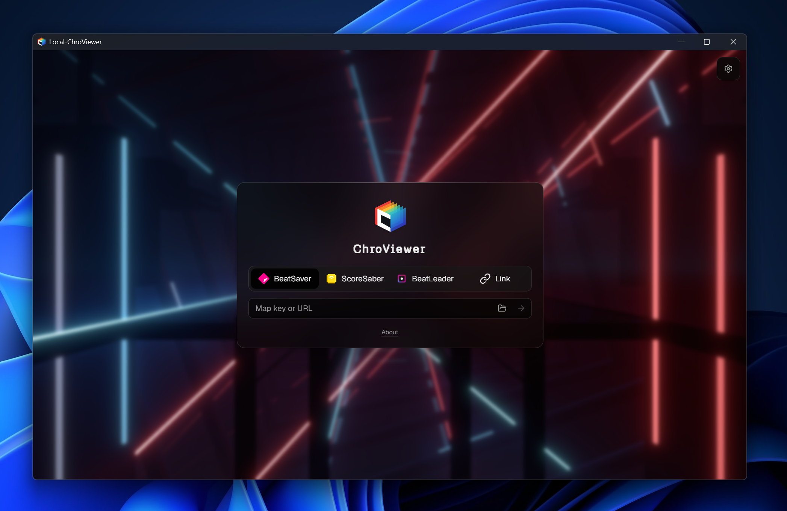

<div align="center">

<p>
<a href="README.zh.md">中文</a> · <a href="README.md">English</a>
</p>

<div align="left">

# Local-ChroViewer

A local-first Beat Saber map & replay viewer — a standalone desktop port of
[ChroViewer](https://github.com/Umbranoxio/chroviewer) running in a native
webview window (pywebview / WebView2), with a Python (FastAPI) backend.

**Local first, cloud fallback**: pick a local `.bsor` replay → the app
automatically resolves the map in your local game directory
(`Beat Saber_Data\CustomLevels`) → playback with zero network traffic. Only
when the map is missing locally (or its version is outdated) does it download
from BeatSaver, cache it in the project's own cache area, and show a live
progress ring while doing so.

<p>

</p>

## Features

- Local `.bsor` replay playback (BeatLeader / ScoreSaber formats), with
  automatic local map resolution (SongCore hash via `SongHashData.dat` cache
  + `CustomLevels` scan)
- Online sources: BeatSaver / ScoreSaber / BeatLeader (search, leaderboards,
  replays) — direct connections where CORS allows, proxied otherwise
- Full upstream ChroViewer rendering engine (environments, lighting, bloom,
  planar mirror, fog, HUD, timeline)
- Map cache: local hit → local zip; miss → BeatSaver download into
  `data/map-cache/` with download-progress feedback in the UI
- Port 4680 by default, auto-fallback to 4681..4699 when occupied
- Double-click a `.bsor` to open it directly (`Local-ChroViewer.exe "x.bsor"`)
- Game-level (OST/DLC) replays: a replay without a custom map hash identifies
  its level by level id, so the game's own levels are playable too
- Missing-map auto-fill (v1.2.0): when a local-first host backend exposes
  `POST /api/maps/{id}/ensure-preview`, a level the host can complete is
  fetched by the host and picked up automatically; a plain ChroViewer server
  does not offer the endpoint and the original "map not found" is reported
- Host playback contract (v1.2.0): an embedder (SaberLab) can stop a replay
  that left the visible page with one `saberlab:playback` message — pause
  only, song position kept, never resumed automatically

## Directory Structure

```
├── web/                 Upstream ChroViewer fork (frontend, GPL-2.0)
├── server/              Python backend (FastAPI: static serving, proxy,
│                        local replay/map channels)
├── launcher/            Package entry (pywebview window)
├── scripts/             build.py (PyInstaller → GitHub_Build/v<version>/),
│                        verification tools
├── saberlab/chro/       SaberLab plugin distribution (GPL-2.0, see below)
└── GitHub_Build/        Packaged output (git-ignored)
```

## Running (development)

Requires Python 3.12+; Node 24.15+ / pnpm 11.20+ only for frontend builds.

```bat
run.bat                         rem starts the local webview window
```

or directly:

```bat
python -m server.launcher                rem local window
python -m server.launcher "xxx.bsor"     rem open a replay directly
```

## Packaging

```bat
python -m pip install -r server\requirements-dev.txt
python scripts\build.py --version 1.2.0  rem outputs to GitHub_Build\v1.2.0\
```

Output (`GitHub_Build\v<version>\`, windowed, no console window):

- `Local-ChroViewer-v<version>\` — run directory: `Local-ChroViewer.exe`
  (webview window) + shared `frontend/` + runtime
- `Local-ChroViewer-v<version>.zip` — release archive

## Frontend Build (web/)

```bat
cd web
pnpm install --frozen-lockfile
pnpm exec vp build        rem produces .output/public (static, prerendered)
```

Localization changes relative to upstream (commit `dd01022`):

- `src/sources/local/provider.ts` (added): local source adapter, level-id
  identity, host-driven map fill (`ensure-preview`)
- `src/core/replay/types.ts`: `replayMapHash` falls back to the level id
- `src/modules/viewer/use-host-playback-commands.ts` (added): host pause
  contract, mounted from `viewer-shell.tsx`
- `src/modules/viewer/use-viewer-remote-source.ts`: `resolveLocalFirst`
  (local-first resolution), download-progress wiring
- `vite.config.ts`: TanStack Start native prerender (`/`)

## SaberLab Plugin (saberlab/chro)

`saberlab/chro` is a **separate distribution** of this project built as a
plugin for [SaberLab](https://github.com/ZiRCON/SaberLab) (a Beat Saber
replay-analysis tool, GPL-3.0-or-later).

It was moved out of the SaberLab repository for **license-compatibility
reasons**: ChroViewer is `GPL-2.0-only`, which is not compatible with
SaberLab's `GPL-3.0-or-later`. Keeping the ChroViewer-derived code in its own
project (this repository), uniformly licensed **GPL-2.0-only**, avoids the
license conflict while still allowing SaberLab to consume it as a plugin.

- See [`saberlab/chro/MODIFICATIONS.en.md`](saberlab/chro/MODIFICATIONS.en.md)
  for the full modification list relative to upstream (local map source,
  client-only mount, removed remote entry points, etc.)
- The directory is a static build output (frontend dist); SaberLab serves it
  at `/chro/` and embeds it in an iframe
  (`/chro/?replayUrl=<origin>/api/replays/{id}/raw`)
- The released `Local-ChroViewer-saberlab-plugin-v<version>.zip` is packed
  from SaberLab's live `plugins/chro`: the same payload with the host bridge
  injected into `index.html` plus `inject_saberlab_bridge.py`, the tool that
  re-applies that bridge after the files are replaced. The payload files in
  this directory and in `plugins/chro` are byte-identical
- That dist predates the TanStack Start build and cannot be regenerated from
  `web/` as it stands; the level-id patch it carries is applied idempotently
  by SaberLab's `_tools/patch_chro_official_replays.py` (`--check` verifies)

## License

- This project: **GPL-2.0-only** (see [LICENSE](LICENSE))
- Frontend fork of [ChroViewer](https://github.com/Umbranoxio/chroviewer)
  (GPL-2.0); rendering engine derived from
  [ChroMapper](https://github.com/Caeden117/ChroMapper) (GPL-2.0, attribution
  in `web/ATTRIBUTIONS.md`)
- `saberlab/chro` plugin: **GPL-2.0-only** (same license as the rest of this
  project — see `saberlab/chro/LICENSE` and `MODIFICATIONS.en.md`)
- Backend format references: [BS-Open-Replay](https://github.com/BeatLeader/BS-Open-Replay)
  (MIT) and [SongCore](https://github.com/Kylemc1413/SongCore) (MIT)
